# Raunak Oberoi

I build apps around problems I run into. 

**Local AI, speech interfaces, and custom harnesses.**

[LinkedIn](https://www.linkedin.com/in/raunakoberoi/)

 

---

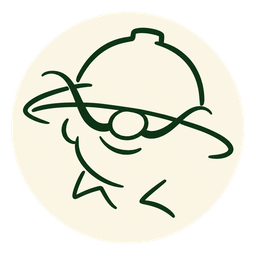 &nbsp; <strong>Shambu</strong> &middot; A quiet, whimsical status app for your private GPU server.

Your GPU is at home, but you need to be out and about. Shambu checks that the two of you are still on speaking terms, with server status, live GPU load, memory usage and 48 hours of activity.

**[Download for Windows, Mac or Android](https://github.com/desigrit/shambu/releases/latest)** &nbsp; / &nbsp; [Repository](https://github.com/desigrit/shambu)

<a href="assets/shambu.png?v=1.0.4">
  <picture>
    <source media="(max-width: 600px)" srcset="assets/shambu-cover-mobile.png?v=1.0.4">
    
  </picture>
</a>

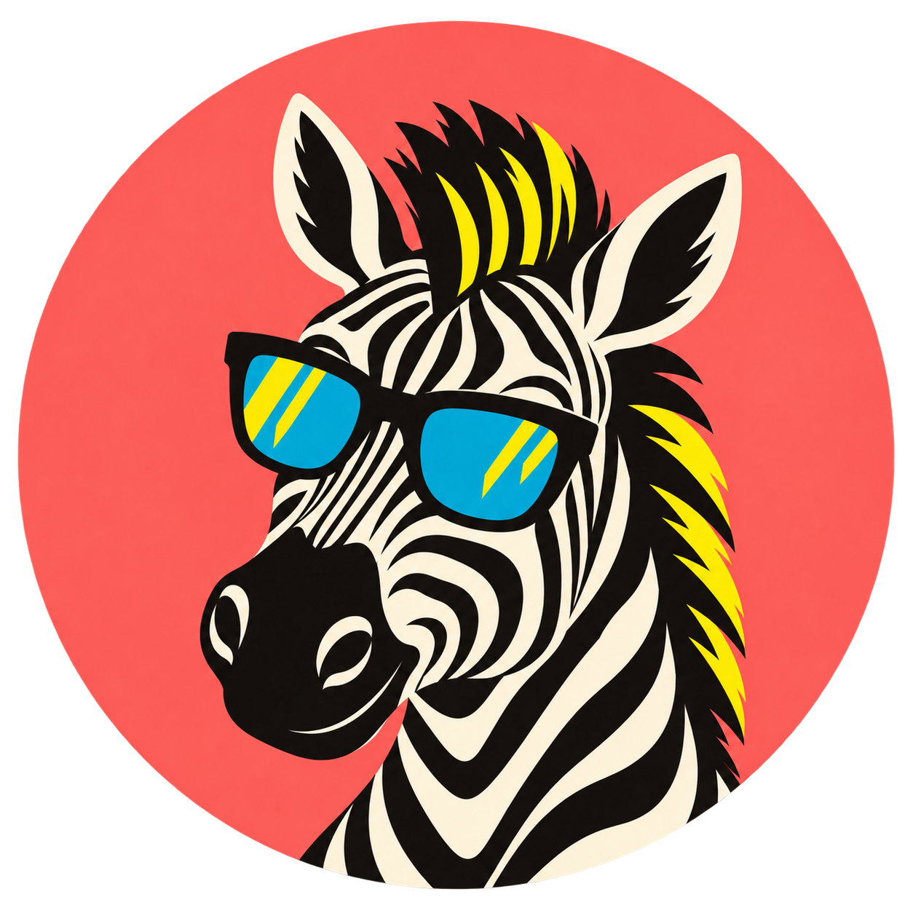 &nbsp; <strong>Zebby the Scout</strong> &middot; Plan a role, prepare your CV and track what happens next.

A desktop app for job seekers, with local models, your own API keys or optional Zebby credits.

**[Download for Windows or Mac](https://github.com/desigrit/zebby-the-scout/releases/latest)** &nbsp; / &nbsp; [Repository](https://github.com/desigrit/zebby-the-scout)

<a href="https://github.com/desigrit/zebby-the-scout/blob/main/docs/screenshots/zebby-collage.png">
  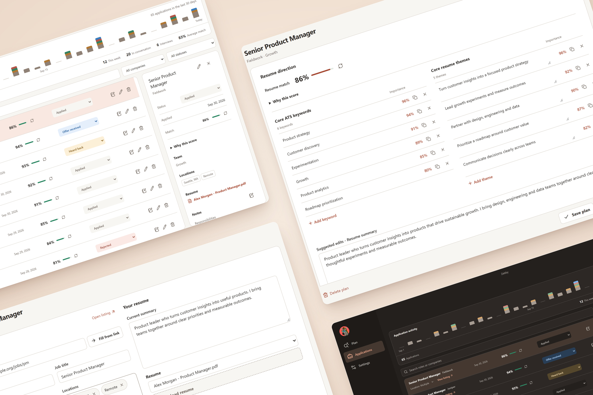
</a>

Sample applications and analysis results.

**Analysis options and credits**

- **Bring your own key:** OpenAI or Anthropic, billed to your provider account.
- **Run locally:** use your Ollama server or download a CPU model in Settings.
- **Zebby credits:** buy a pack for online analysis, then choose GPT-6.1 Sol or GPT-6 Astra. No signup or API key needed.

**Your own API key**

**Optional credit packs**

Zebby shows the maximum credit cost before analysis and charges for actual usage. A recovery code restores your wallet; computer pairing shares it across your PCs.

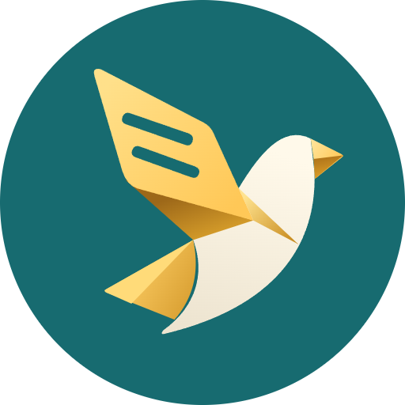 &nbsp; <strong>Kaptus</strong> &middot; Companion captions for films and television.

Currently an early Android preview.

**[Download Android preview](https://github.com/desigrit/kaptus/releases/latest/download/Kaptus-preview.apk)** &nbsp; / &nbsp; [Repository](https://github.com/desigrit/kaptus)

<a href="assets/kaptus.png">
  <picture>
    <source media="(max-width: 600px)" srcset="assets/kaptus-cover-mobile.png">
    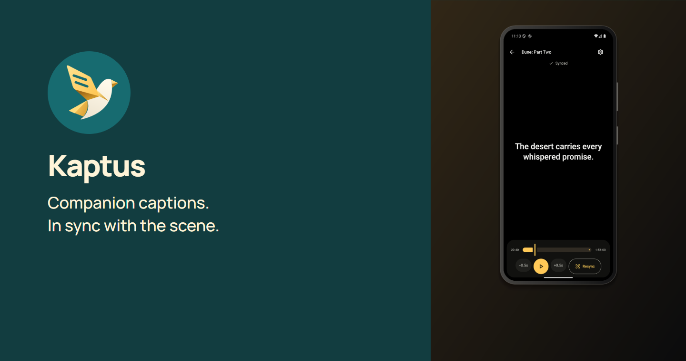
  </picture>
</a>

Android product mockup with illustrative subtitle text.

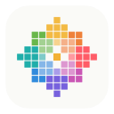 &nbsp; <strong>Rangoli</strong> &middot; Color picker with a live swatch preview for your Mac.

A menu-bar eyedropper with a live swatch, a nearby color name, and one-click copying in Hex, RGB, HSL, HSV, CMYK, or Lab. Open it with Control-Option-C, pick a pixel, and get back to what you were doing.

**[Download for Mac](https://github.com/desigrit/rangoli-picker/releases/latest/download/Rangoli-macOS-arm64.zip)** &nbsp; / &nbsp; [Repository](https://github.com/desigrit/rangoli-picker)

<a href="assets/rangoli.png">
  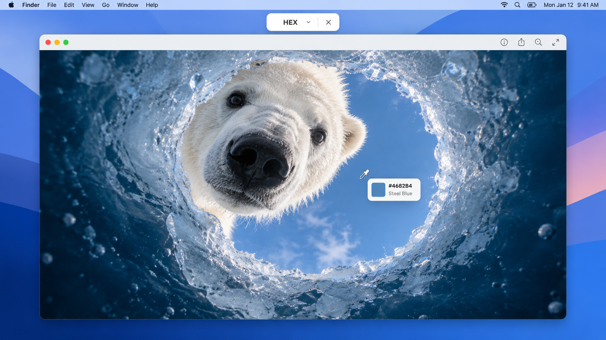
</a>

Illustrative desktop mockup from the Rangoli README, inspired by Audun Rikardsen's Icy Window. Actual picker UI below.

   &nbsp;
  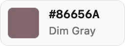

 &nbsp; <strong>Sunno</strong> &middot; Live, on-device captions for conversations.

Speaker labels and native Windows and Mac apps.

**[Download for Windows](https://get.microsoft.com/installer/download/9msv0v6jv8hk?referrer=appbadge&cid=sunno-github)** &nbsp; / &nbsp; **[Download for Mac](https://github.com/desigrit/sunno-macos/releases/latest)** &nbsp; / &nbsp; [Windows source](https://github.com/desigrit/sunno) &nbsp; / &nbsp; [Mac source](https://github.com/desigrit/sunno-macos)

<a href="assets/sunno.png">
  <picture>
    <source media="(max-width: 600px)" srcset="assets/sunno-cover-mobile.png">
    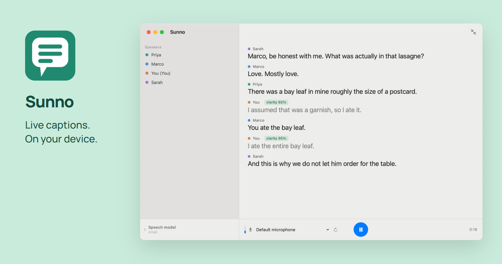
  </picture>
</a>

macOS interface with a demo conversation. Select the image for a closer look.

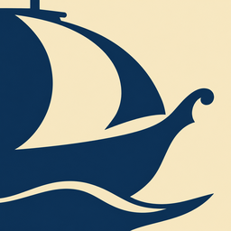 &nbsp; <strong>Spice Route</strong> &middot; Cross-device continuity for Codex.

Selected conversations, project files, and Git state move through an existing cloud drive.

**[Download for Windows or Mac](https://github.com/desigrit/project-spice-route/releases/latest)** &nbsp; / &nbsp; [Repository](https://github.com/desigrit/project-spice-route)

<a href="assets/spice-route.png">
  <picture>
    <source media="(max-width: 600px)" srcset="assets/spice-route-cover-mobile.png">
    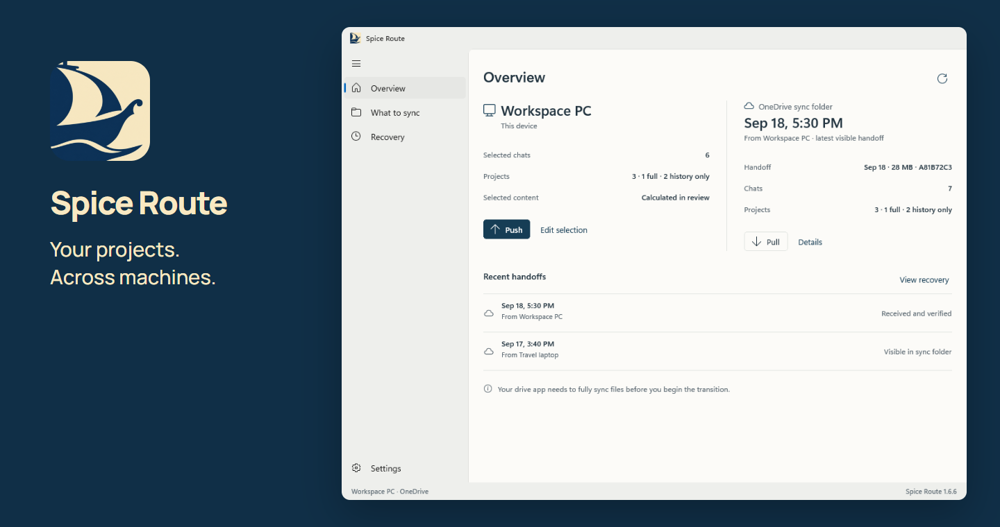
  </picture>
</a>

 &nbsp; <strong>ESL Hub</strong> &middot; Household dashboards on e-paper displays.

A Raspberry Pi system that turns retail e-paper displays into household dashboards.

**[Download source](https://github.com/desigrit/esl-home-hub/archive/refs/heads/main.zip)** &nbsp; / &nbsp; [Raspberry Pi setup](https://github.com/desigrit/esl-home-hub#setup) &nbsp; / &nbsp; [Repository](https://github.com/desigrit/esl-home-hub)

  <a href="assets/esl-hub-tags.jpg">
    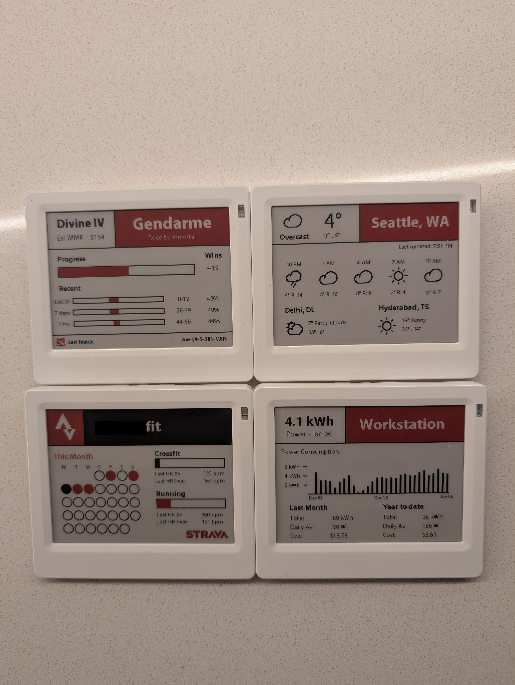
  </a>

