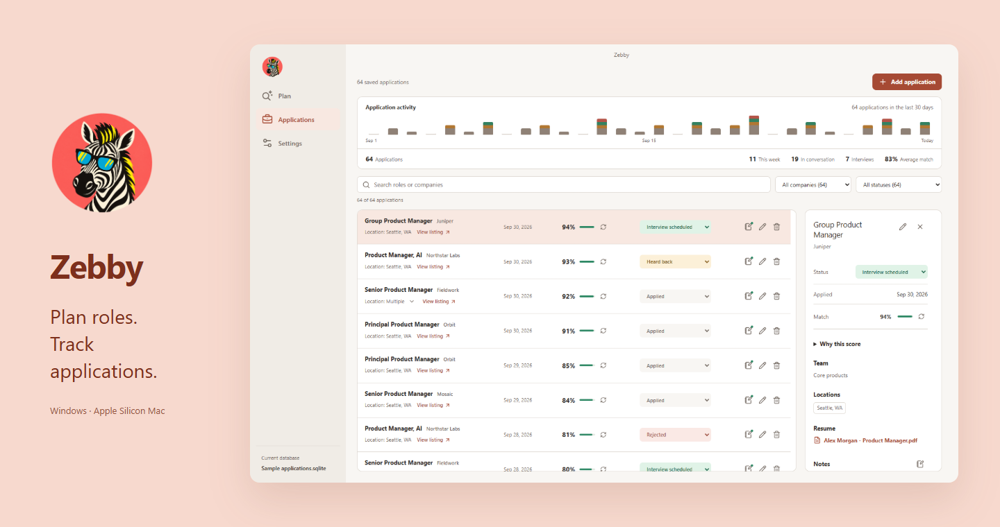
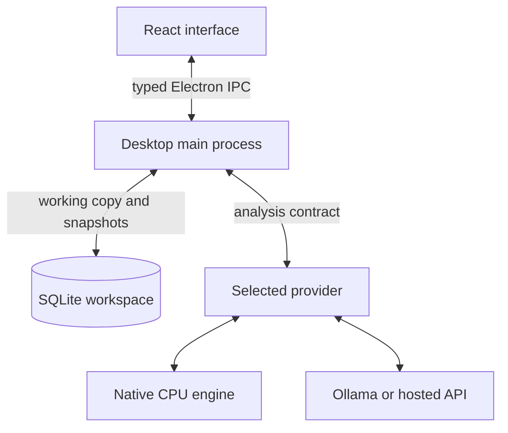
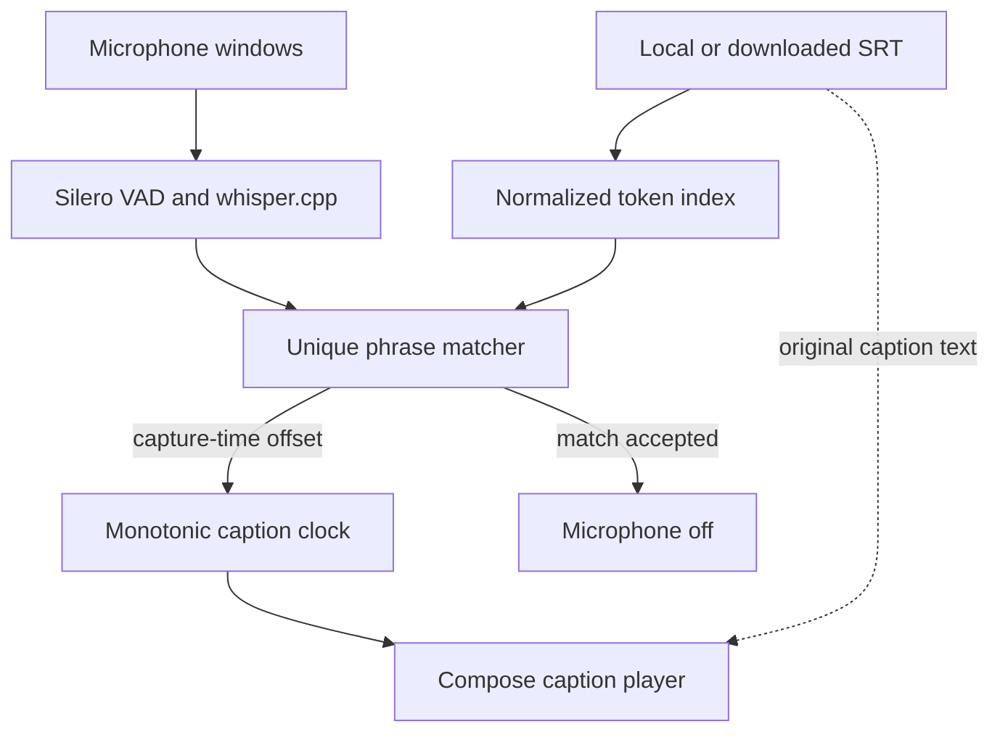
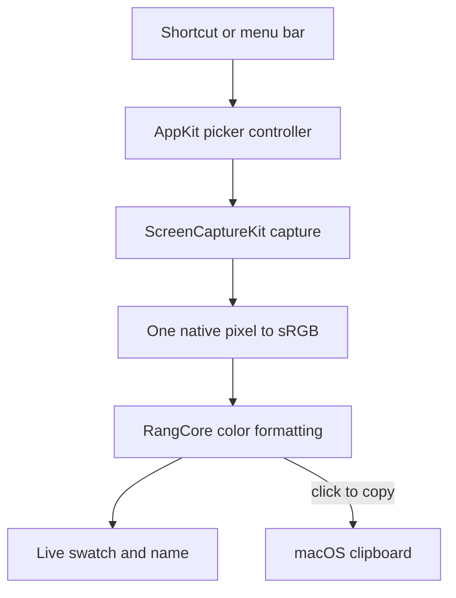
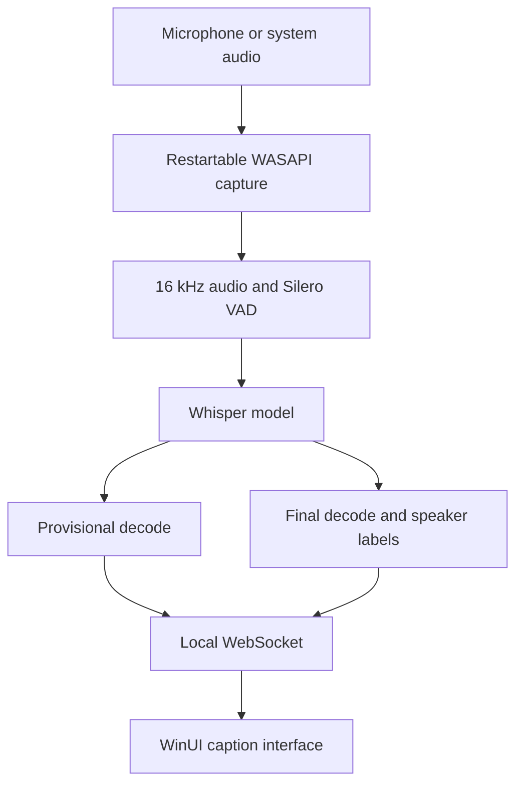
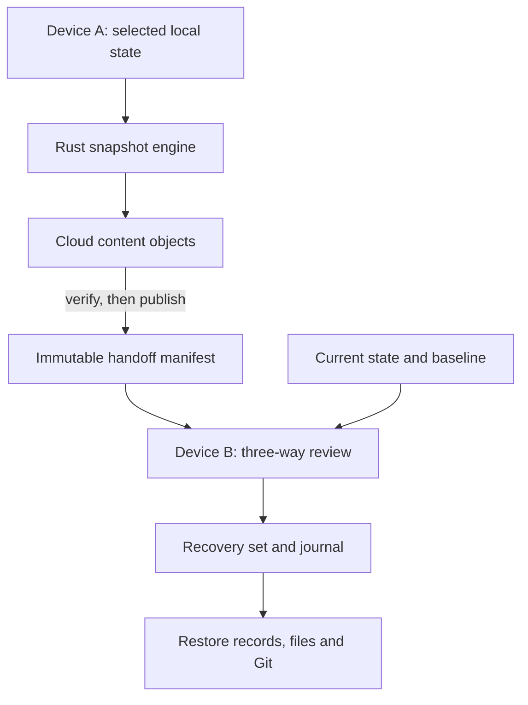
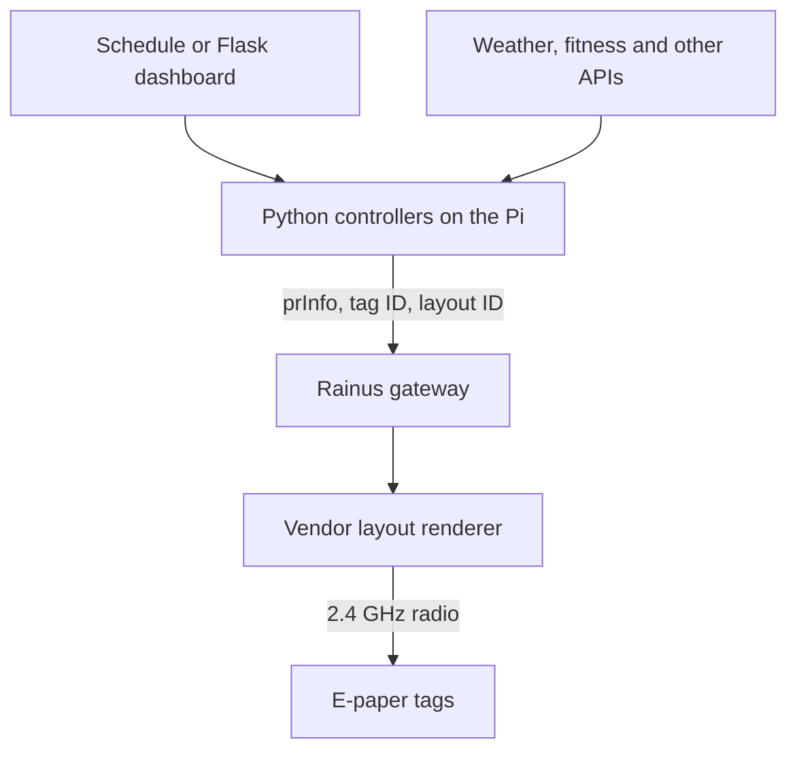

# Raunak Oberoi

**Local AI, speech interfaces, and custom harnesses.**

I build apps around problems I run into.

[LinkedIn](https://www.linkedin.com/in/raunakoberoi/)

 

###  &nbsp; [Zebby](https://github.com/desigrit/zebby-the-scout)

**A desktop workspace for role planning and application tracking.** History, documents, and the reasoning for each application in one place.

<a href="assets/zebby.png">
  <picture>
    <source media="(max-width: 600px)" srcset="assets/zebby-cover-mobile.png">
    
  </picture>
</a>

Sample application data.

**[Download for Windows or Mac](https://github.com/desigrit/zebby-the-scout/releases/latest)** &nbsp; / &nbsp; [Repository](https://github.com/desigrit/zebby-the-scout)

Inside the build / Technical notes

Built with Electron, React, TypeScript, SQLite, and a native CPU inference engine.

- **Portable data, local credentials.** Plans, applications, and resumes live in a user-selected SQLite file. The app works on a local copy and saves complete snapshots, checking for outside changes before writing. Keys and model weights stay outside the shared file; simultaneous edits on two computers are not merged.
- **An explicit model choice.** Built-in models, a chosen Ollama server, and hosted providers share an analysis contract. A failed request does not silently switch providers or models, and oversized inputs produce an error instead of hidden truncation.
- **Keep inference out of the interface.** A typed Electron bridge separates the React UI from storage and analysis. The bundled engine runs in a separate process, listens only on loopback with an app-generated secret, and releases memory when idle.

[Build guide and storage decisions](https://github.com/desigrit/zebby-the-scout/blob/main/docs/guide.md) &nbsp; / &nbsp; [Analysis routing](https://github.com/desigrit/zebby-the-scout/blob/main/desktop/analysis-routing.ts)

 

###  &nbsp; [Kaptus](https://github.com/desigrit/kaptus)

**Companion captions for films and television.** Currently an early Android preview.

<a href="assets/kaptus.png">
  <picture>
    <source media="(max-width: 600px)" srcset="assets/kaptus-cover-mobile.png">
    
  </picture>
</a>

Android product mockup with illustrative subtitle text.

**[Download Android preview](https://github.com/desigrit/kaptus/releases/latest/download/Kaptus-preview.apk)** &nbsp; / &nbsp; [Repository](https://github.com/desigrit/kaptus)

Inside the build / Technical notes

Built with Kotlin, Jetpack Compose, Room, whisper.cpp, and Silero voice activity detection.

- **Find the scene, then stop listening.** On-device recognition locates a phrase in the chosen subtitle track. A confident match starts a monotonic playback clock and turns the microphone off. The displayed captions come from the original SRT text.
- **Stay with the current dialogue.** Overlapping six-second windows use a latest-only recognition queue, so stale audio cannot build up. Matching normalizes transcript and subtitle tokens, requires a unique match, and compensates for transcription time using the audio capture timestamp.
- **Prepare before going offline.** Local SRT files work without an account. OpenSubtitles tracks can be saved ahead of time; the speech model is bundled. Microphone audio stays in memory, and subtitle-service credentials use Android Keystore.

[Synchronization decisions](https://github.com/desigrit/kaptus#how-synchronization-works) &nbsp; / &nbsp; [Playback clock](https://github.com/desigrit/kaptus/blob/main/app/src/main/java/com/example/kaptus/sync/MonotonicPlaybackClock.kt)

 

###  &nbsp; [Rangoli](https://github.com/desigrit/rangoli-picker)

**Pick a color anywhere on your Mac.** A menu-bar eyedropper with a live swatch, a nearby color name, and one-click copying in Hex, RGB, HSL, HSV, CMYK, or Lab. Open it with Control-Option-C, pick a pixel, and get back to what you were doing.

Illustrative desktop mockup from the Rangoli README, inspired by Audun Rikardsen's Icy Window. Actual picker UI below.

   &nbsp;
  

**[Download for Mac](https://github.com/desigrit/rangoli-picker/releases/latest/download/Rangoli-macOS-arm64.zip)** &nbsp; / &nbsp; [Repository](https://github.com/desigrit/rangoli-picker)

Inside the build / Technical notes

Built with Swift, AppKit, and ScreenCaptureKit, with no third-party dependencies. The release targets Apple Silicon and macOS 14 or later.

- **Sample the actual pixel.** The sampler maps the pointer into native display pixels, captures without scaling, crops one pixel, then converts it to sRGB. That avoids averaging neighboring Retina pixels or confusing display points with pixels.
- **Keep the picker out of its own sample.** ScreenCaptureKit excludes Rangoli's windows by process identity. Capture and cursor tracking run during a picking session, and the panels disappear after copying or cancellation.
- **Make the color math explicit.** Formatting lives in a separate core module. Names are nearest matches from the CSS color list; CMYK is an sRGB approximation, and Lab uses a D50 white point. These are documented limits on color matching.

[Pixel sampling implementation](https://github.com/desigrit/rangoli-picker/blob/main/Sources/Rang/ScreenSampler.swift) &nbsp; / &nbsp; [Color conversions](https://github.com/desigrit/rangoli-picker/blob/main/Sources/RangCore/ColorMath.swift)

 

###  &nbsp; [Sunno](https://github.com/desigrit/sunno)

**Live, on-device captions for conversations.** Speaker labels and native Windows and Mac apps.

<a href="assets/sunno.png">
  <picture>
    <source media="(max-width: 600px)" srcset="assets/sunno-cover-mobile.png">
    
  </picture>
</a>

macOS interface with a demo conversation. Select the image for a closer look.

**[Download for Windows](https://get.microsoft.com/installer/download/9msv0v6jv8hk?referrer=appbadge&cid=sunno-github)** &nbsp; / &nbsp; **[Download for Mac](https://github.com/desigrit/sunno-macos/releases/latest)** &nbsp; / &nbsp; [Windows source](https://github.com/desigrit/sunno) &nbsp; / &nbsp; [Mac source](https://github.com/desigrit/sunno-macos)

Inside the build / Technical notes

The Windows app pairs WinUI 3 with a local Python speech service. The Mac app has a SwiftUI interface and its own native audio integration. The diagram below shows the Windows Whisper pipeline.

- **Balance early words with stable sentences.** The Whisper path uses one model for a fast provisional pass and a final beam-search pass. Corrections settle at utterance boundaries. Whisper's accent handling drove the choice; small streaming models remain an option for machines without a GPU.
- **Measure the actual pipeline.** In one recorded GPU benchmark, greedy decoding took 322 ms in FP16 versus 374 ms in INT8/FP16, so quantization did not earn its expected speed advantage on that setup. Conservative audio conditioning avoids clipping useful speech with aggressive denoising.
- **Separate recovery from recognition.** Windows capture runs in a disposable child process. A stalled device can be restarted while the loaded speech engine, speaker roster, and recorder stay alive. Recognition stays local, and recording is an explicit action.

[Engineering choices and measurements](https://github.com/desigrit/sunno/blob/master/docs/ENGINEERING.md) &nbsp; / &nbsp; [Mac audio recovery](https://github.com/desigrit/sunno-macos/blob/main/docs/AUDIO-RECOVERY.md)

 

###  &nbsp; [Spice Route](https://github.com/desigrit/project-spice-route)

**Cross-device continuity for Codex.** Selected conversations, project files, and Git state move through an existing cloud drive.

<a href="assets/spice-route.png">
  <picture>
    <source media="(max-width: 600px)" srcset="assets/spice-route-cover-mobile.png">
    
  </picture>
</a>

**[Download for Windows or Mac](https://github.com/desigrit/project-spice-route/releases/latest)** &nbsp; / &nbsp; [Repository](https://github.com/desigrit/project-spice-route)

Inside the build / Technical notes

A shared Rust core sits behind the Windows WinUI 3 shell and the Mac Tauri interface.

- **Use the cloud drive as transport.** Selected chat records, files, attachments, and Git state become compressed, content-addressed objects. Push copies and verifies those objects before publishing the manifest, so a partial upload cannot advertise a complete handoff.
- **Review before restoring.** Pull compares the incoming state, current local state, and their common ancestor. Divergent edits become explicit conflicts. A recovery set and durable journal exist before live files change, with integrity checks after restoration.
- **Respect database and machine boundaries.** Adapters check the Codex build, migrations, and schema fingerprints. Only selected records are exported. Destination paths and permission policies stay local; an incoming snapshot is not permission to overwrite an entire profile.

[Transfer and recovery architecture](https://github.com/desigrit/project-spice-route/blob/main/docs/architecture.md) &nbsp; / &nbsp; [Compatibility policy](https://github.com/desigrit/project-spice-route/blob/main/docs/compatibility-plan.md)

 

###  &nbsp; [ESL Hub](https://github.com/desigrit/esl-home-hub)

A Raspberry Pi system that turns retail e-paper displays into household dashboards.

  

**[Download source](https://github.com/desigrit/esl-home-hub/archive/refs/heads/main.zip)** &nbsp; / &nbsp; [Raspberry Pi setup](https://github.com/desigrit/esl-home-hub#setup) &nbsp; / &nbsp; [Repository](https://github.com/desigrit/esl-home-hub)

Inside the build / Technical notes

Built with Python, Flask, APScheduler, a Rainus InforTab gateway, and retail e-paper tags.

- **Reuse hardware built to hold information.** The tags keep their image without a backlight or continuous refresh. A few scheduled updates make more sense for these dashboards than an always-running tablet screen.
- **Separate data from layout.** Each controller turns API data into an indexed string array, paired with a tag ID and layout ID. The gateway renders the vendor-designed layout and sends the image over its own 2.4 GHz radio; the Pi does not render the tag's screen.
- **Give every data source the same entry point.** Controllers expose run(full_config) and can run from the scheduler or Flask dashboard. Credentials stay in local configuration, while the gateway sits on a separate network segment behind the Pi.

[Controller contract and data flow](https://github.com/desigrit/esl-home-hub#how-it-works) &nbsp; / &nbsp; [Application and scheduler](https://github.com/desigrit/esl-home-hub/blob/main/app.py)

